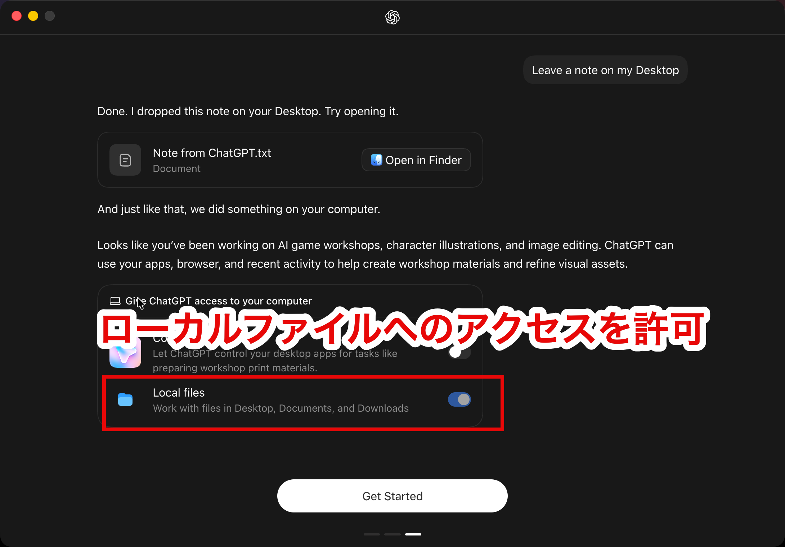
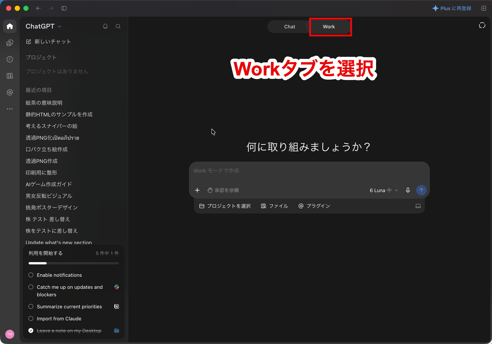
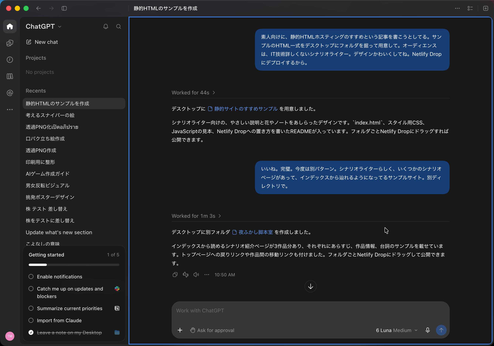
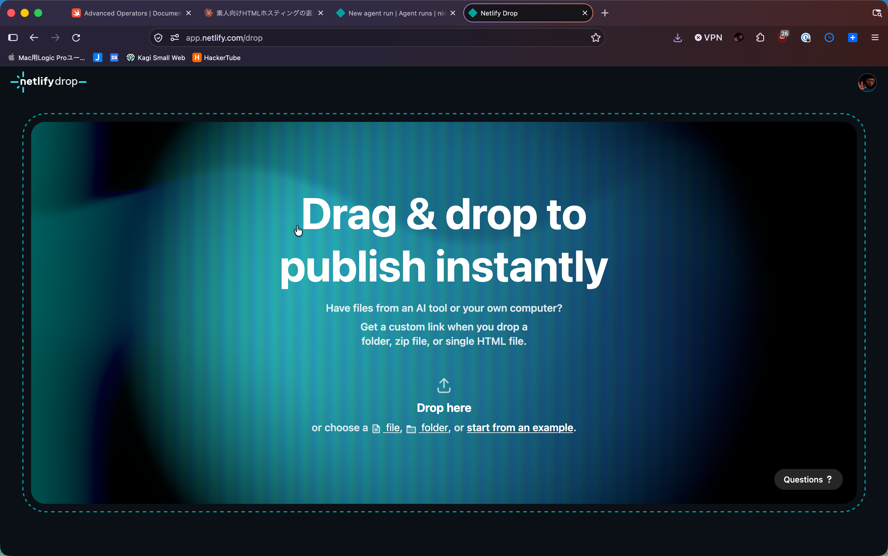
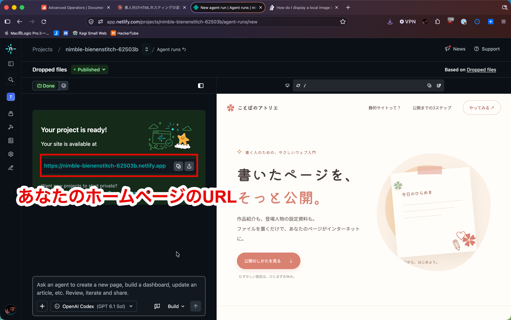
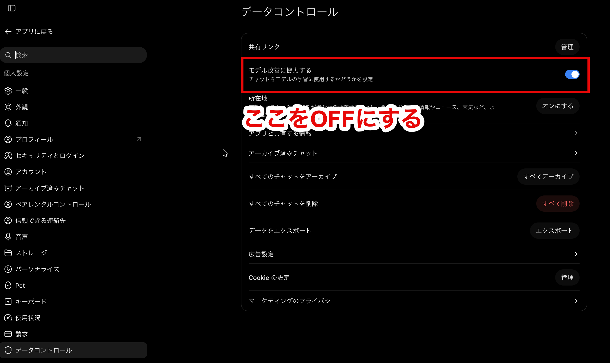

# ChatGPTとNetlify Dropによる自前ホームページ構築のすすめ

## はじめに

[Ameba Ownd](https://www.amebaownd.com/)が、昨今世間を騒がせているAIによるセキュリティー騒ぎの余波で[サービス終了](https://blog.amebaownd.com/posts/59351287)してしまうようです。Ameba Owndは、HTMLなどの専門的な知識がなくても、自分のオリジナルデザインで作品を公開できる場を与えてくれるすばらしいサービスだっただけに残念です。わたしの好きなシナリオライターにもAmeba Owndで自分の作品を公開している人が何人かいて、突然の発表に途方に暮れているようでした。

HTMLの知識がない人でも自前サイトを構築する手段として、WordPressという、はるか古より存在するツールがあります。とても広く普及しており、依然として人気のあるツールです。しかし、これもあまりおすすめできないのです。WordPressを使って自分のサイトをカスタマイズする際には、さまざまなプラグインをインストールして運用することになると思います。実はこれが問題です。WordPressにはさまざまなプラグインが提供されていて簡単に導入できますが、その品質は玉石混淆。WordPressの脆弱なプラグインは、しばしば悪意あるハッカーによる攻撃の的になります。それを避けるためには、危険の少ないプラグインを見極め、新に発見される脆弱性にも目を光らせた上で、バージョンの更新を徹底する必要があります。一言で言えば、難易度が高いのです。ですから、個人的にはおすすめしません。

前置きが長くなりましたが、この記事では、これらの手段の変わりに、専門知識も必要なく、自由度が高く自分の表現ができ、また安全に運用できるおすすめのやりかたを紹介します。あ、もちろんクレジットカード等登録しなくても無料ではじめられます。

> [!CALLOUT]
>
> ちなみに、この記事自体も、これから紹介するやりかたで書かれ、公開されています。

## 使うもの

わたしのおすすめする方法では、2つのサービスを使います。

* ChatGPT
* Netlify Drop

ChatGPTについてはおそらくご存知だと思いますが、Netlify Dropは初耳かもしれませんね。ですが、とても便利で簡単に使えるサービスなので、ご安心を。

わたしのおすすめするやりかたは、専門的な言いかたをすると静的サイトホスティングと呼ばれるやりかたで、ある意味もっとも古来からある由緒正しい方法です。つまり、HTMLを書いて、サーバーにアップロードする。要はこれだけです。サーバー上の複雑なシステムは不要なので、セキュリティー的にも安心です。

> [!CALLOUT]
>
> なお、本記事はパソコンでの作業を前提とします。スマホやタブレットのみで静的サイトを構築することも技術的に可能とは思いますが、本記事の範囲外です。

違うのは、ChatGPTとNetlify Dropを使うことによって、その工程が極限まで簡単になり、専門知識がなくても実行できるということです。では具体的な手順に移りましょう。

## 手順

1. [ChatGPT](https://chatgpt.com/ja-JP/)利用登録
2. [ChatGPTデスクトップ](https://chatgpt.com/ja-JP/download/)のダウンロード
3. ChatGPTデスクトップにサイトを制作させる
4. [Netlify Drop](https://app.netlify.com/drop)利用登録
5. Netlify Dropにドラッグアンドドロップ

この5ステップで公開できます。われわれはChagGPTにHTMLを書かせるつもりなので、なにはともあれChatGPTの利用登録が必要です。そして次に、ChatGPTのデスクトップアプリをダウンロードします。ChatGPTにデスクトップアプリがあるのは、もしかするとあまり知られていないかもしれません。実は、デスクトップアプリを使うことで、AIが真のパワーを発揮できるのです。具体的には、ChatGPTが自分の代わりにパソコンを操作して、いろいろなことをやってくれるようになります。今回は、HTML一式をChatGPTに書かせて、フォルダーに保存させます。ですので、インストール後の手順に従って、ローカルファイルへのアクセスを許可してください。

また、ChatGPTにパソコンを操作させるときには、「Work」タブを選択しておく必要があります。

これで準備ができたので、さっそくサイト制作です。といっても、難しいことはありません。ChatGPTにHTMLを書いてとお願いするだけです。制作したHTMLは、あとでNetlify Dropにアップロードする予定なので、そのことを伝えておくとスムーズでしょう。自分の制作したいサイトのイメージや雰囲気があるなら、そのサイトをChatGPTに見せたり、スクリーショットを与えれば、似た雰囲気のデザインにしてくれます。どのような目的で何を制作しているのかをAIに具体的に伝えることで、助言や提案をしてくれるはずです。

さて、これでHTMLができたので、次はNetlify Dropの利用登録をします。Netlify Dropは、自分のHTMLをインターネット上に公開するためのサービスです。基本無料で使えます。その最大の特徴は、アップロードと公開が極限まで簡単にできることです。Netlify Dropの利用登録が完了したら、もう公開は目の前です。

手順は、この画面に、HTMLが格納されたフォルダをドラッグ&ドロップするだけ。

数十秒後には、あなたのホームページは世界に発信されます。ね、簡単でしょう?残念ながら、Netlify Drop自体は日本語表示には対応していません 。

> [!CALLOUT]
>
> あなたのホームページを日本語で公開できないということではなく、Netlify Dropでホームページを管理するときに、英語の説明を読まなければいけないということです。

しかし、ここでもChatGPTが役に立ちます。Netlify Dropの操作でわからないことがあれば、ChatGPTに質問しましょう。あなたのかわりにネットを検索して、丁寧にやりかたを教えてくれます。

以上、ChatGPTとNetlify Dropを使って、ホームページを制作し、インターネット上に公開する方法を説明しました。さっそくあなたの制作物を世界に公開してみましょう。

## サンプル

前述したように、この記事自体がChatGPTとNetlify Dropで制作されています。同様の方法で制作したサンプルページを参考に置いておきます。

* [書いたページを、そっと公開。｜静的サイトのすすめ](https://nimble-bienenstitch-62503b.netlify.app/)
* [夜ふかし脚本室｜シナリオ作品集](https://taupe-elf-7bca0b.netlify.app)

## Q&A

### 無料なの?

ChatGPTはある程度まで無料です。無料枠ではあまりたくさんの更新はできないかもしれません(この記事の範囲では無料でまかなえました)。無料枠を越えたら、1400円/月から使えます。

Netlify Dropは月300クレジットまで無料です。1回の公開操作に15クレジットかかります。無料枠を越える場合、$9/月のPersonalプランが必要です。

* [プランと料金 | ChatGPT](https://chatgpt.com/ja-JP/pricing/)
* [Pricing and Plans | Netlify](https://www.netlify.com/pricing/)

### ChatGPTを使ったら自分のコンテンツが学習されちゃうのでは?

設定で学習をオフにできます。デフォルトでは学習ONになっているので、学習されたくない方はOFFにしてください。

### https://ABC-XYZ.netlify.app みたいなURLになっちゃうの?

無料で使っている分には、この形式のURLでホストされますが、Netlify Drop上から自分の独自ドメインを購入することもできますし、すでに自分のドメインを持っている場合は、それをNetlify Dropに向けて設定することもできます。

### 既存サイトからコンテンツを移行したい

基本的に、ChatGPTに自分のコンテンツを渡して、「移行して」とか、「このコンテンツを元にサイトを制作して」と一言言えば、移行してくれるはずです。Ameba Owndも近日中にエクスポート機能を公開するようなので、エクスポートしたデータをそのままChatGPTに渡せば、データ移行してくれるでしょう。

### Netlify Dropがサ終したらどうするの?

これがこの方法の最大の利点で、仮にNetlify Dropがサ終したとしても、HTMLはあなたの手元にあるので、他のホスティングサービスにそのままアップロードすればいいだけです。そのようなサービスは無数にあります。独自ドメインを取得した場合も、ドメインは他の業者に移管できます。

----

2026.11.3 スナイパー <sniper@tai2.net>